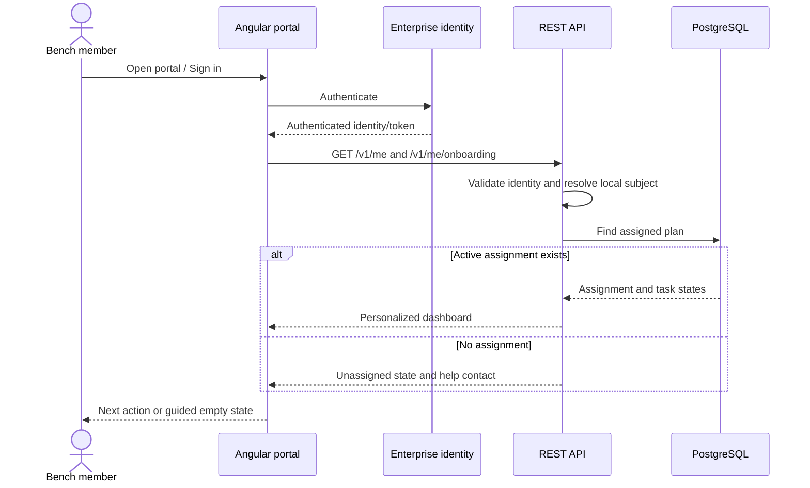
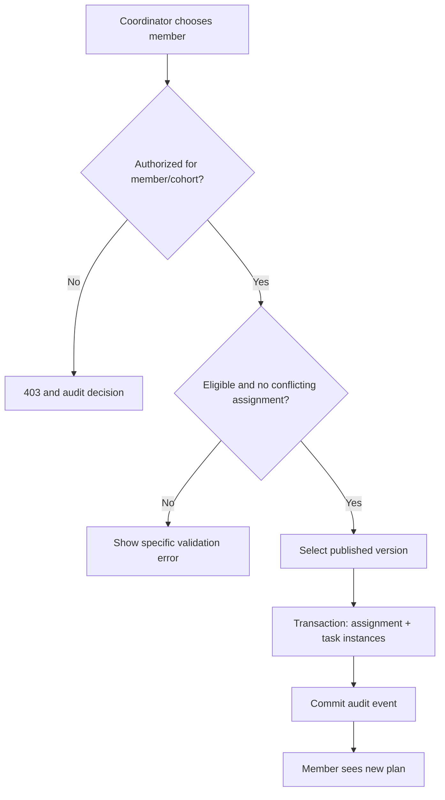
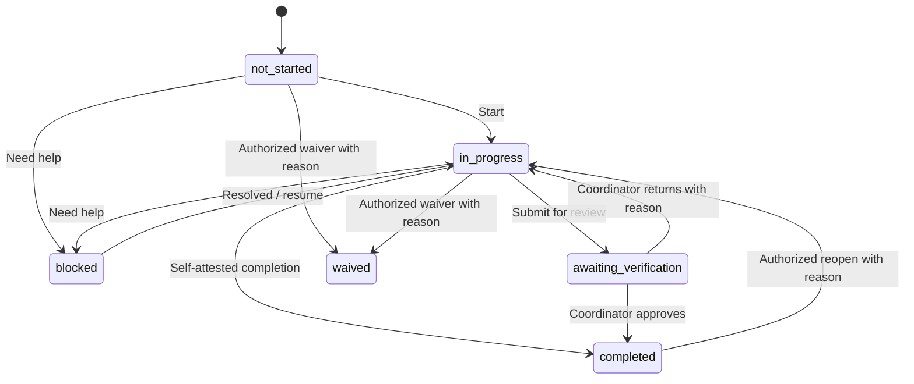
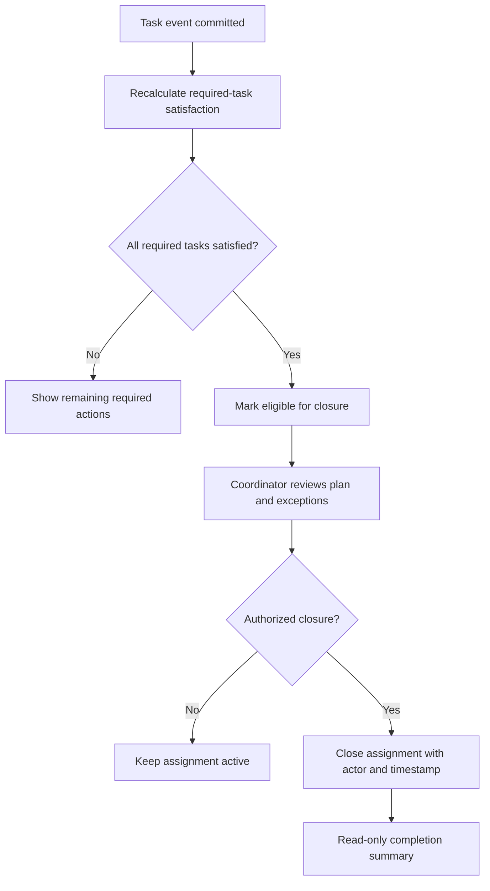
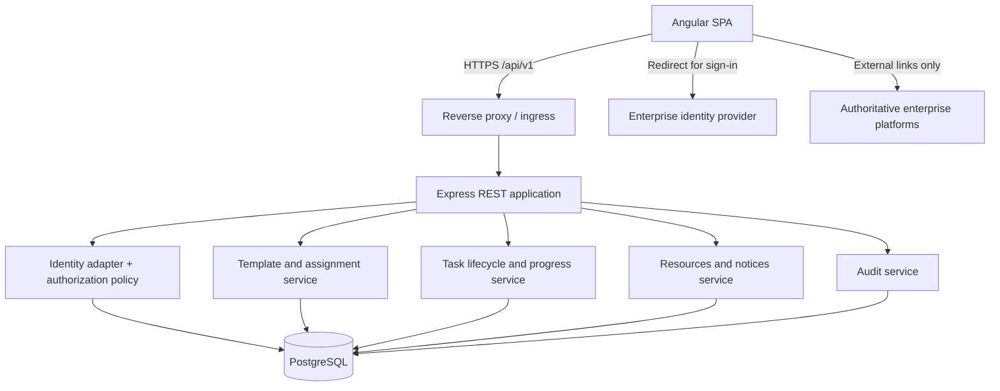
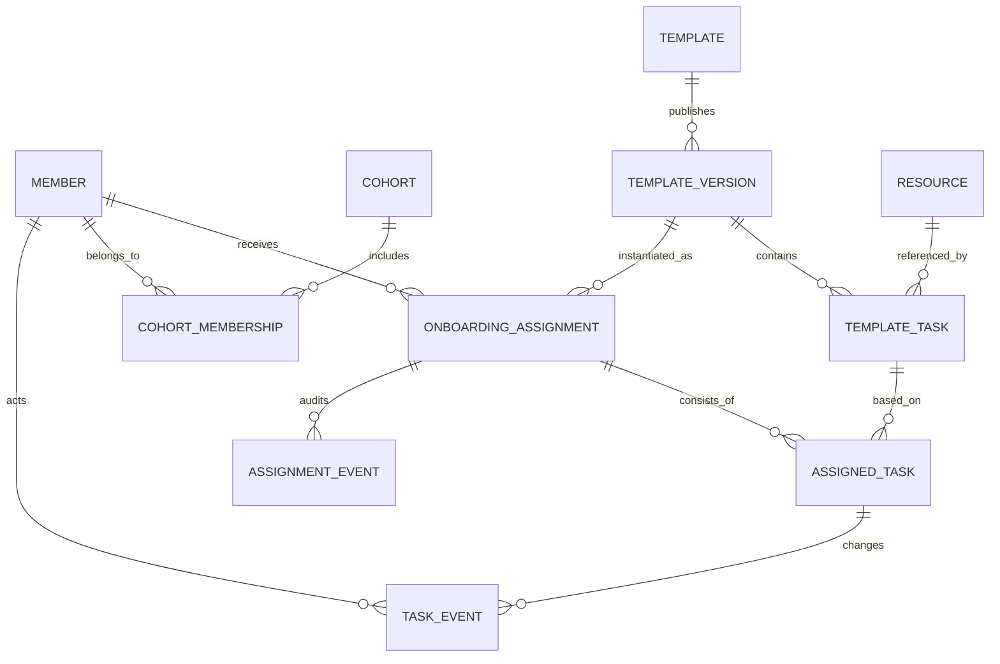

# Song Bench Onboarding Portal
## Solution Architecture Design (SAD)

**Document ID:** SONG-SAD-001  
**Version:** 1.0 (Proposed Baseline)  
**Status:** Proposed — requires product, security, and operations approval  
**Date:** 20 October 2026  
**System:** Song Bench Onboarding Portal  
**Classification:** Internal working design — contains no production secrets

> **Purpose of this document:** Define the intended solution as if architecture work had preceded development. Existing code is treated as a source of evidence, **not** as a binding product specification. All target-state descriptions are proposals until approved and implemented. This is an architecture design, not a claim that the system currently satisfies it.

---

## Document control

| Item | Details |
|---|---|
| Business owner | Song Bench onboarding owner — to assign |
| Product owner | Bench coordinator representative — to assign |
| Architecture owner | Solution architect — to assign |
| Engineering owner | Application team — to assign |
| Reviewers | Identity/security, data/privacy, operations, accessibility, bench coordinators |
| Decision status | Proposed, not yet an accepted ADR |
| Approval gates | Scope and flows; security and data; MVP acceptance; deployment readiness |

### Version history
| Version | Date | Change |
|---|---|---|
| 1.0 | 2026-10-20 | Reconstructed product-first architecture baseline from current repository and proposed target state |

### Reading guide
- **Current-state observation:** directly indicated by source files or existing documents.
- **Target design:** proposed functionality or engineering approach, not necessarily implemented.
- **Open decision:** needs accountable owner and formal approval.

---

# 1. Executive summary

Song Bench Onboarding Portal is a **small, secure, task-oriented web application** for members entering Song Bench and for the coordinators managing their onboarding. It is a single entry point for the required steps, reference materials, completion evidence, and assistance. It does not replace corporate HR, learning, talent, compliance, or skill systems.

**Primary outcome:** A person joining the bench knows what to do next, can resume where they left off, and can demonstrate completion; an authorized coordinator can assign, monitor, support, and close that person's onboarding without changing another member's task state.

**Architectural choice:** Angular web client + versioned Express REST API + PostgreSQL relational persistence, deployed as a modular monolith. Reuse existing identity foundations and authoring infrastructure only where they contribute to the MVP. Security, identity resolution, and authorization are enforced server-side. SQLite may remain for fast local tests, but PostgreSQL is the qualified production database.

**Release gate:** Two different members must be able to complete the same template independently, through sign-out/restart, without any cross-member data leakage; a coordinator sees correct aggregated state; a member cannot assign, approve, or alter another member's onboarding.

# 2. Business context and problem definition

## 2.1 Problem statement

The existing application combines generic site pages, an individual-looking journey, task tracking, a training tracker, links, announcements, and privileged content editing. Its current API operations update shared task status, so the architecture cannot reliably support independent per-person onboarding progress. Documentation focuses heavily on technical decisions rather than defining a product journey end to end.

## 2.2 Business objectives

| ID | Objective | Measurable acceptance |
|---|---|---|
| BO-01 | One clear starting point | Member dashboard shows assignment and next action on first authenticated visit |
| BO-02 | Consistent onboarding | Approved templates produce consistent task sets and instruction versions |
| BO-03 | Individual accountability | Each task state and event is attributable to one assignment and actor |
| BO-04 | Operational visibility | Coordinator can view assigned members, outstanding required tasks, and blockers |
| BO-05 | Minimal operational burden | One administrator can update templates/resources without code changes for ordinary text/link edits |
| BO-06 | Trustworthy completion | Required tasks and approvals determine completion, not a manually edited percentage |

## 2.3 Intended benefits

Reduced onboarding ambiguity, fewer recurring coordinator questions, visibility into blocked tasks, and a durable completion record. No unsupported numerical efficiency or ROI claim is assumed.

## 2.4 Success measures

- Assignment coverage: eligible arrivals assigned an active plan.
- First-action rate: assigned members opening and beginning their plan.
- Completion rate and elapsed time by approved template, without punitive individual rankings.
- Blocker count and aging; unresolved tasks requiring coordinator intervention.
- Usability and reliability: end-to-end task flows and accessibility verification.

# 3. Scope and boundaries

## 3.1 In-scope MVP

1. Corporate sign-in and mapped member identity.
2. One active onboarding assignment per member per defined onboarding cycle.
3. Template-driven stages, required/optional tasks, sequencing, and instructions.
4. Personal task transitions and stored completion evidence metadata.
5. External resource links and help/contact pathways.
6. Coordinator member directory, assignment, progress, blocking, verification and closure.
7. Administrator template publication and limited resource management.
8. Audited changes, standard errors, telemetry and basic operational runbooks.

## 3.2 Explicitly out of scope for MVP

- Replication or editing of HR records, talent profiles, skills inventories, curricula, or corporate compliance records.
- Automated synchronization of completion from external platforms without sanctioned APIs.
- Employee performance scoring, project staffing/ranking, talent matching, timesheets, approval hierarchies, social feeds, organization chart, AI tutors, autonomous agents, general-purpose CMS, custom form builder, or mass messaging.
- Broad role management UI unless existing authorized identity administration cannot satisfy access requirements.
- Storage of CV files or sensitive compliance evidence by default.

## 3.3 System context and ownership

| System/actor | Relationship | Authority |
|---|---|---|
| Member browser | Interacts with portal | Own task self-reporting where allowed |
| Bench coordinator | Assigns and verifies | Assignment and verification authority within assigned scope |
| Administrator | Configures templates and reference material | Publishing and configuration authority |
| Enterprise identity provider | Establishes authenticated employee identity | Identity authority |
| HR, learning, skills and compliance systems | External destinations (links at MVP) | Authoritative for their underlying business data |
| Portal database | Stores onboarding plans and portal event history | Authoritative only for portal-specific assignment/progress |

**Important boundary:** A self-reported click on “done” is *not* proof that an external training or compliance system shows completion. Tasks requiring validation must use coordinator verification or a subsequently approved integration.

# 4. Stakeholders, actors and access model

| Actor | Can view | Can change | Cannot do |
|---|---|---|---|
| Guest/not signed in | Sign-in/help information only | Nothing persisted | Read member/coordinator records |
| Member | Own active plan, own task history and public resources | Own eligible task states, support request | Edit templates, approve own verification, see another member's plan |
| Coordinator | Authorized cohort/assigned member plans, blockers and reports | Assign template; verify/reopen tasks; close onboarding with reason | Edit global role grants or bypass policy |
| Administrator | Published/draft templates and resource catalog | Draft/publish templates and manage authorized settings | Fabricate member completion or bypass auditable approvals |
| Support operator (optional) | Limited diagnostics | Approved support operations | Access sensitive evidence by default |

Coordinator assignment scope is mandatory in multi-coordinator use. Roles are not sufficient by themselves: all data access checks must additionally enforce **resource ownership or cohort membership**. Default deny on missing mapping.

# 5. Functional architecture and requirements

## 5.1 Capabilities

| ID | Capability | MVP priority | Behavior |
|---|---|---|---|
| FR-01 | Sign in | Must | Resolve enterprise subject to local member ID; show safe error on mismatch |
| FR-02 | Member dashboard | Must | Stage summary, required tasks, next action, blockers, help |
| FR-03 | Assigned plan | Must | Immutable snapshot of published template/version at assignment |
| FR-04 | Task lifecycle | Must | Mark start, self-complete, request help, add permitted completion note |
| FR-05 | Verification | Must | Coordinator accepts/rejects tasks requiring verification; reason and actor captured |
| FR-06 | Assignment | Must | Coordinator enrolls member from eligible roster/mapped identity; prevent duplicates |
| FR-07 | Progress | Must | Derived from required tasks and verification, not stored as editable percentage |
| FR-08 | Exception handling | Must | Blocked, waived with reason/authority, reopened, overdue advisory indicator |
| FR-09 | Resource links | Must | Relevant instructions and canonical links on each task |
| FR-10 | Coordinator view | Must | Search/filter by assigned scope, state, stage and blockers |
| FR-11 | Template publishing | Must | Draft and publish controlled template versions; no retroactive silent change |
| FR-12 | Audit trail | Must | Who changed what, for whom, when, prior/new state, reason where required |
| FR-13 | Announcements | Should | Read published notices; editing can initially use existing guarded feature |
| FR-14 | CSV reporting | Later | Authorized export with privacy/data minimization and retention controls |
| FR-15 | Notifications | Later | Reminder/alert only after channel, opt-out and governance decisions |

## 5.2 Content model and proposed onboarding stages

These stages are **starter content for review by actual bench owners**, not assertions about official policies. Each task has title, why it matters, procedure, external URL (if applicable), owner, required flag, dependency, expected effort (optional), verification rule, help contact, and last review date.

| Stage | Example tasks | Evidence/verification approach |
|---|---|---|
| 1. Welcome & orientation | Read bench guide; understand points of contact and support path | Self-attestation |
| 2. Personal readiness | Confirm contact guidance; review profile/update instructions | External link + self-attestation; never copy protected personal data |
| 3. Skills & learning | Visit skills profile; review relevant learning paths; record next learning action | Self-attestation or coordinator verification as needed |
| 4. Engagement readiness | Review CV/profile preparation guidance; understand resource and availability processes | External link and limited completion status |
| 5. Review & closeout | Resolve open blockers; coordinator reviews all required items | Computed eligibility + coordinator close action |

No stage should be renamed to imply that the portal certifies external-system completion.

# 6. User experience and end-to-end process flows

## 6.1 Global navigation

- **Member:** Dashboard → My Onboarding → Task Detail → Resources & Help → Profile/Sign Out.
- **Coordinator:** Coordinator Dashboard → Members → Member Onboarding → Verify/Resolve → Assignment Management.
- **Administrator:** Templates → Draft/Edit → Preview → Publish → Resources → Audit.
- Visible options follow roles, while the backend remains the actual security boundary.
- Empty/no-plan state must say *No onboarding assigned* and provide the correct coordinator contact, not show misleading 0% progress.

## 6.2 Flow A: First visit and assignment

**Preconditions:** User has an identity-provider account and is eligible for onboarding; template published.



**Exception paths:** Invalid session → sign-in; unrecognized identity → contact support without auto-provisioned privileges; inactive assignment → historic read-only view; unavailable API → error/retry, never fabricated completion.

## 6.3 Flow B: Coordinator creates onboarding assignment

1. Coordinator signs in; server checks `onboarding:assign` and allowed cohort.
2. Coordinator selects eligible member and active published template.
3. System checks duplicate active cycle, eligibility and existing assignment.
4. In a transaction, it creates assignment, copies/version-pins template tasks, and initializes all task states to `not_started`.
5. System records who assigned, template version, date, and audit event.
6. Member dashboard now shows the assigned journey on next refresh.

**Exceptions:** Duplicate request returns existing assignment or conflict deterministically; unpublished template rejected; out-of-scope coordinator gets 403; partial failure rolls back transaction.



## 6.4 Flow C: Member performs and completes a task

1. Member opens own plan; API returns task instances scoped to caller.
2. Member opens task and reads its goal, instructions, references, acceptance rule and help contact.
3. Member chooses `Start`, opening `in_progress`, or `Need help`, opening `blocked` with optional safe description.
4. For a self-attested task: user submits `Complete`; backend validates allowed transition and writes `completed`.
5. For a verified task: user submits `Ready for review`; backend writes `awaiting_verification`, not `completed`.
6. System atomically adds a state history/audit event and returns recalculated progress.
7. Member sees the next actionable required task; dependencies stay unavailable until cleared, with explanation.

**Exceptions:** Repeated submit is idempotent; stale version returns 409 and reload instruction; invalid notes are rejected; disabled/offboarded account cannot mutate.



`waived` fulfills a requirement only if an explicit policy says waived tasks count as satisfied; it remains visible and attributed. Unverified `awaiting_verification` never counts as complete.

## 6.5 Flow D: Coordinator monitors and resolves blockers

1. Coordinator opens cohort view and filters `blocked` or `awaiting_verification`.
2. API enforces cohort membership before returning member summaries.
3. Coordinator opens a member's plan with latest activity, tasks and permitted comments.
4. For verification, coordinator approves or returns task with reason; self-verification of coordinator's own task is prohibited where independent review is required.
5. For blocker resolution, coordinator records instruction/action and transitions task to `in_progress`, or applies an authorized waiver with mandatory reason.
6. Member subsequently sees updated task state and explanation.

## 6.6 Flow E: Completing the onboarding assignment



A percentage reaching 100 does **not** automatically imply coordinator closure. Completed assignments remain accessible under retention policy; reopening requires an explicit authorized transition and reason.

## 6.7 Flow F: Administrator edits/publishes template

Draft → edit stages/tasks/dependencies/instructions → validate (required fields, valid links, no dependency cycles) → preview as member → publish immutable version → available for *new* assignments. Existing active plans keep pinned version; any migration to a newer template requires a distinct, authorized migration process with audit, not silent mutation.

## 6.8 Flow G: Offboarding, re-entry, and exceptional cases

- An inactive user cannot create new task events; retained history follows retention rules.
- Member returning for a new cycle receives a new assignment; prior cycle preserved separately.
- Template retired: cannot be selected for new assignments, but existing assignments remain readable.
- Removed external link: task shows reviewed alternative/help contact; completion status is not erased.
- No internet/failed external platform: portal can record `blocked`, not claim external requirement complete.

# 7. Information architecture and screen inventory

| Route (proposed) | Screen | Primary functions | Access |
|---|---|---|---|
| `/` | Welcome / redirect | Sign in, support | Public limited |
| `/dashboard` | My dashboard | Progress, next task, announcements | Member |
| `/onboarding` | My plan | Ordered stages, filters, status | Member |
| `/onboarding/tasks/:id` | Task details | Instructions, links, state change, request help | Owner |
| `/resources` | Resource directory | Curated links, owner, review date | Authenticated |
| `/help` | Help | Coordinator contact and escalation | Authenticated |
| `/coordinator` | Cohort dashboard | Pending review, blockers, summary | Coordinator |
| `/coordinator/members` | Member roster | Search, assignment | Coordinator scoped |
| `/coordinator/members/:id` | Member plan | Verify, waive, resolve, close | Coordinator scoped |
| `/admin/templates` | Templates | Draft/publish/retire | Administrator |
| `/admin/templates/:id` | Template editor | Stages, dependencies, publish checks | Administrator |
| `/admin/audit` | Audit lookup | Restricted investigation | Authorized admin |

**Consolidate existing duplicated Journey and Training Tracker experiences** into a single task presentation with stage/category metadata. Avoid exposing implementation-centric page names in primary navigation.

# 8. Logical application architecture



## 8.1 Component responsibilities

| Component | Ownership | Key rule |
|---|---|---|
| Angular UI | Navigation, accessible forms, present server state | No authoritative role/progress calculation |
| Identity adapter | Validate tokens/session; map stable subject | Never accept client-supplied user ID as identity |
| Policy layer | RBAC plus resource/cohort permissions | Fail closed and enforce on every read/write |
| Template service | Validate and publish immutable versions | Assignment pins template version |
| Assignment service | Enrollment and cycle lifecycle | Transactional, avoids duplicate active plans |
| Task service | Transition validation and task instance writes | All state changes audited and optimistic-locked |
| Progress projection | Computes remaining, completed and closure eligibility | Deterministic from task instance states |
| Resource service | Canonical links/instructions ownership | Review/expiry metadata |
| Audit service | Immutable event trail | No secrets or sensitive unneeded payloads |
| Repository/database | Transactions and migrations | PostgreSQL authoritative in production |

## 8.2 Deployment architecture

Angular static build served behind HTTPS reverse proxy; `/api/v1` routes to stateless Express instances; PostgreSQL on managed or approved internal database service with backups and restricted networking; enterprise identity provider handles sign-in. Browser never connects to database. Health/readiness probes and structured logs are exposed only to approved operations. Exact cloud subscription, DNS, network and secret manager are deployment decisions, not invented facts in this document.

## 8.3 Constraints and implementation principles

Modular monolith; API-first contracts; validated input; single source of truth; no cross-user state; no hidden automatic external data sync; controlled template versions; privacy by design; tested restore; accessible responsive UI; no AI or async orchestration requirement in MVP.

# 9. Data architecture

## 9.1 Conceptual entities



## 9.2 Proposed entity dictionary

| Entity | Key fields | Semantics |
|---|---|---|
| `members` | id, enterprise_subject UNIQUE, display_name, active | Local identity mapping, minimal profile |
| `cohorts` | id, code, title, status | Coordinator scope/group |
| `cohort_memberships` | member_id, cohort_id, effective dates | Prevents access to unrelated members |
| `templates` | id, name, status | Stable onboarding definition |
| `template_versions` | id, template_id, version, published_at, published_by | Immutable released definition |
| `template_tasks` | id, template_version_id, stage, title, order, required, verification_mode, dependency_ids, instructions, resource_id | Published task requirements |
| `assignments` | id, member_id, template_version_id, cycle_key, cohort_id, assigned_by, assigned_at, status, closed_at | Personal onboarding instance |
| `assigned_tasks` | id, assignment_id, template_task_id, status, version, updated_at, completed_at | Member-specific task status |
| `task_events` | id, assigned_task_id, actor_id, event_type, from_status, to_status, reason, timestamp | Append-only transitions |
| `assignment_events` | id, assignment_id, actor_id, event_type, reason, timestamp | Assignment audit |
| `resources` | id, title, url, owner, reviewed_at, status | Curated links and help material |

Identity IDs should not be email addresses: use stable provider subject and map internally. Add unique `(member_id, cycle_key)` where business cycle semantics allow; otherwise use a partial uniqueness constraint for one active assignment per cycle. Index assignment by member/cohort/status and task by assignment/status. Use foreign keys, migration versioning, constrained states and server timestamps.

## 9.3 Data rules

1. Published template versions are immutable; assignment snapshots reference the exact version.
2. A member may only mutate tasks attached to their own active assignment and in permitted status transitions.
3. Every task change and coordinator override creates an append-only history record in the same transaction.
4. Persist task state, not a separately editable percentage. Progress is derived, cached only with clear invalidation if performance warrants.
5. External system completion is never inferred from page visits or raw links.
6. No uploaded sensitive documents in MVP. Store minimum required evidence metadata, not corporate records themselves.
7. Data retention and deletion schedules require privacy owner approval before rollout.

## 9.4 Progress formula

`progress = satisfied_required_tasks / total_required_tasks × 100` (where `satisfied` means `completed` or an explicitly authorized counting waiver); if there are zero required tasks, show `Not configured`, not 100%. Optional items display separately. Closure status is distinct from progress.

# 10. Interface and integration architecture

## 10.1 REST API outline (proposed `/api/v1`)

| Method | Endpoint | Purpose | Authorization |
|---|---|---|---|
| GET | `/me` | Identity and role context | Signed in |
| GET | `/me/onboarding` | My active/historic assignment summary | Member owner |
| GET | `/me/onboarding/tasks` | Personal tasks/stages | Member owner |
| GET | `/me/onboarding/tasks/{id}` | Details/instructions | Member owner |
| POST | `/me/onboarding/tasks/{id}/transitions` | Start, complete, block, submit for review | Member owner |
| GET | `/resources` | Published resources | Signed in |
| GET | `/coordinator/members` | Authorized member roster and filters | Coordinator cohort |
| POST | `/coordinator/assignments` | Assign published template | Coordinator cohort |
| GET | `/coordinator/assignments/{id}` | Assignment and task details | Coordinator cohort |
| POST | `/coordinator/tasks/{id}/decisions` | Approve, return, waive, reopen | Coordinator cohort |
| POST | `/coordinator/assignments/{id}/close` | Close eligible assignment | Coordinator cohort |
| GET | `/admin/templates` | List drafts/published | Administrator |
| POST | `/admin/templates` | Create draft | Administrator |
| PUT | `/admin/templates/{id}/draft` | Revise draft | Administrator |
| POST | `/admin/templates/{id}/publish` | Validate/publish version | Administrator |

POST transition example:

```json
{
  "action": "submit_for_verification",
  "expectedVersion": 3,
  "note": "Completed the required step in the linked system"
}
```

Response includes stable task ID, status, incremented version, UTC time, and derived assignment summary. Use HTTP 400 validation, 401 unauthenticated, 403 unauthorized, 404 inaccessible/unknown as policy permits, 409 stale state, 422 illegal transitions, 429 throttled, and 5xx internal failures. Return correlation ID in each error; never leak personal records or token details.

## 10.2 Integration boundaries

- **Identity:** Trust validated enterprise authentication only; verify issuer, audience, signature, expiry and mapped subject. Local development identity must be disabled outside loopback development.
- **External resources:** curated links. No unauthorized APIs or screen scraping. Add deep links only where approved.
- **Future integrations:** separate versioned adapters after formal data owner, permission, reconciliation and failure-mode review.

# 11. Security, privacy and compliance design

- HTTPS in production; secure browser session/token handling appropriate to the approved identity topology; no tokens in URLs or logs.
- Resource-level authorization checked for every endpoint, independent of client route guards.
- Least-privilege coordinator scoping, author/publisher separation, and mandatory reasons on override actions.
- Validate input schema, enforce size/length limits, sanitize or escape displayed notes, protect against injection and CSRF where cookie sessions are used, throttle sensitive endpoints.
- Database credentials in approved secrets storage; encryption at rest/in transit, backups, restricted access; rotate credentials through standard operations.
- Minimize PII: member identifier/name, cohort, progress and workflow events only. Do not collect health, financial, skills assessment contents, CV documents or confidential HR material.
- Maintain immutable audit history with redacted payloads and access logs, authorized viewing, retention approval.
- Privacy/security review must decide retention, lawful/internal basis, subject access and deletion handling, and monitoring boundaries before go-live.

# 12. Quality attributes and non-functional requirements

| ID | Attribute | Design/acceptance target |
|---|---|---|
| NFR-01 | Availability | Service-level objective to be agreed by operations; graceful errors, no false completion |
| NFR-02 | Performance | Target p95 API response under 500 ms for normal reads at agreed load (excluding external sign-in); measure in staging |
| NFR-03 | Data integrity | Zero cross-member updates; all state/audit writes atomic |
| NFR-04 | Reliability | Recover after restart with identical persisted state |
| NFR-05 | Security | No high/critical unresolved security findings at release; negative authorization tests |
| NFR-06 | Accessibility | WCAG 2.2 AA design target; keyboard flow and screen reader verification |
| NFR-07 | Observability | Correlation ID, structured logs, health/readiness, error and DB latency metrics |
| NFR-08 | Recoverability | Defined backup schedule, tested restore, approved RPO/RTO prior to production |
| NFR-09 | Maintainability | Modular domain services and migrations; documented configuration/runbooks |
| NFR-10 | Compatibility | Supported enterprise desktop/mobile browsers per owner-approved matrix |
| NFR-11 | Privacy | Minimized fields and bounded access/reporting; retention policy approved |

# 13. Operations and lifecycle management

## 13.1 Environments

**Local:** Angular + Express + SQLite optional for rapid tests; development authentication loopback only.  
**CI/integration:** Automated unit, API contract and database migration tests; production-database parity against ephemeral PostgreSQL.  
**Staging:** Production-like reverse proxy, enterprise auth, PostgreSQL, seeded nonproduction users; browser E2E including role separation.  
**Production:** Approved ingress, secrets, monitoring, backup/restore, incident ownership and rollback strategy.

## 13.2 Deployment and rollback

Build immutable frontend/backend artifacts; run lint/typecheck/unit/integration/E2E and dependency scans; migrate DB using backward-compatible steps; deploy to staging; run smoke tests with separate member/coordinator accounts; approve production; monitor errors and successful sign-in/task transitions. Roll back binaries via deployment strategy, not destructive DB rollback. Data migrations require tested rollback or forward-fix strategy.

## 13.3 Operational support

Maintain owner directory and incident escalation; log correlation IDs without raw identity tokens; separate user errors from server faults; track failed sign-ins, 403 trends, transition conflicts, migration failures, high latency and stale links. Task history is the principal operational troubleshooting source for progress discrepancies.

# 14. Verification strategy and acceptance scenarios

| Test ID | Scenario | Expected result |
|---|---|---|
| AT-01 | Member A and B share template | Different task instance IDs and independent progress |
| AT-02 | A completes required self-attested task | Only A changes; audit created; progress recalculates |
| AT-03 | A tries B's task ID | Access denied; no B data leaked or updated |
| AT-04 | B submits verification-required task | Pending review, not counted complete |
| AT-05 | Coordinator approves eligible B task | B task becomes completed with decision actor/reason history |
| AT-06 | Coordinator outside B cohort tries approval | 403 and no mutation |
| AT-07 | Browser refresh, logout/login, API restart | Same persisted assignment states and history |
| AT-08 | Duplicate assignment request | Deterministic nonduplicate result, no duplicate tasks |
| AT-09 | Task update with stale version | 409, no overwritten state |
| AT-10 | Template v2 published | Existing v1 assignment unchanged; new assignment receives v2 |
| AT-11 | All required tasks complete but not closed | Eligible for closure but still active until coordinator closes |
| AT-12 | Blocked/waived/reopened task | Valid transitions only, mandatory reason and audit |
| AT-13 | Auth expired and dev mode production request | Secure rejection and no insecure bypass |
| AT-14 | External resource unavailable | User receives honest retry/help path, no automatic completion |
| AT-15 | Accessibility/keyboard journey | All MVP primary flows operable and understandable |
| AT-16 | PostgreSQL migration and backup restore | Constraints and prior state survive migration/restore |

**Definition of Done:** The full journey is demonstrated on staging with two separate members, one coordinator, an approved template, verification-required item, blocker, closure, persistence, negative authorization cases and documented release evidence.

# 15. Repository assessment and fit-gap analysis

These observations are **not** target design requirements. They identify what may be reused or retired.

| Existing element | Evidence | Current fit | Target action |
|---|---|---|---|
| Angular standalone routes | `src/app/app.routes.ts` | Multiple legacy and duplicate navigation paths | Consolidate around member/coordinator/admin workspaces |
| My Journey screen | `src/app/song-bench/my-journey/` | Presentation basis; not evidence of independent per-user progress | Refactor to assignment-instance APIs |
| Training Tracker | `src/app/song-bench/training-tracker/` | Overlapping state/progress concepts | Merge as category/stage in same plan |
| Task/progress API | `backend/server.js` GET `/api/tasks`, PUT status, GET progress | Shared task mutation model | Replace with owned assigned-task transition APIs |
| User-progress table | `backend/migrations*/005-relational-content.sql` | Partial schema seam, not authoritative active workflow | Evaluate migration/replacement with explicit assignments |
| Identity and development auth | `backend/auth/`, ADR-0035 | Useful basis, requires production verification | Preserve fail-closed identity boundary |
| RBAC | migrations and authorization tests | Useful permission foundation | Add ownership and coordinator-cohort checks |
| Announcement authoring | `backend/content/`, ADR-0036/0037 | Secondary value vs onboarding core | Retain read-only at MVP, defer extensive authoring |
| API documentation | `docs/openapi/song-site.yaml` | Existing contract reflects old operations | Publish new versioned onboarding endpoints |
| ADR library | `docs/adr/` | Extensive point decisions, no singular product-first design | Ratify SAD and align/change superseded ADRs |
| Deployment docs | `docs/runbooks/`, CI workflows | Useful operational assets | Qualify against staging and production checks |

### Document consistency risks

- `docs/navigation-flows.md` refers to local/demo routing and a planned user-admin experience; published documentation must distinguish runtime facts from proposals.
- Existing route names include `/journey` and `/my-journey`; the new user model must deliberately migrate or redirect rather than preserve conflicting semantics.
- Separate SQLite/PostgreSQL schema evolution has parity risks; production behavior needs dedicated PostgreSQL integration tests.

# 16. Migration strategy from the current application

**Phase 0 — Baseline and stop scope growth.** Approve business flows, task catalog owners, template/assignment lifecycle, privacy review, and this SAD. Freeze unrelated page features. Capture current data for migration study.

**Phase 1 — Domain foundation.** Implement member mapping, cohorts, templates/versions, assignments, task instances, events, owner-scoped authorization, transactions and migrations. Add two-user API tests.

**Phase 2 — Real member journey.** Replace shared progress APIs behind new Angular dashboard/task pages; support self-attested and verification-required states; instructions, links and help; resume/restart tests.

**Phase 3 — Coordinator and administration.** Add assignment, review, blockers, waiver, closure, template draft/publish, scoped reporting and immutable change history.

**Phase 4 — Qualification and cutover.** Enterprise auth integration, PostgreSQL staging, security/privacy testing, cross-user E2E, backup/restore and smoke test. Redirect legacy URLs. Remove unsafe mutation endpoints after audit. Announce controlled pilot.

### Data migration decision

Do **not** blindly reinterpret shared legacy `tasks.status` as member completion. Existing shared statuses lack trustworthy member attribution. Preserve old data read-only for audit if required, migrate *task definitions* into a draft template after owner review, and initialize new assignments explicitly. If member-specific historical evidence exists outside those shared statuses, migrate only with verified identity mapping and business-owner sign-off.

# 17. Architecture decision register

| ID | Proposed decision | Rationale | Status |
|---|---|---|---|
| AD-01 | Product is onboarding coordination, not broad intranet | Small coherent user promise | Proposed |
| AD-02 | Single modular monolith | Low operational complexity | Proposed |
| AD-03 | Member-specific assignment is source of truth | Prevents cross-user progress | Proposed |
| AD-04 | Published template versions immutable | Reproducible onboarding | Proposed |
| AD-05 | PostgreSQL production authoritative | Transactional relational lifecycle | Proposed |
| AD-06 | Server-side RBAC + owner/cohort checks | Avoids UI-only security | Proposed |
| AD-07 | External systems linked, not copied | Minimize scope and governance risk | Proposed |
| AD-08 | Completion and closure are separate | Avoids misleading 100%-equals-approved assumption | Proposed |
| AD-09 | No sensitive document uploads initially | Privacy and operational simplicity | Proposed |

## 17.1 Existing ADRs to reconcile

ADR-0001 (baseline), ADR-0003 (DB), ADR-0005 (RBAC), ADR-0006 (Journey), ADR-0011/0012 (domain), ADR-0019/0020 (identity/data), ADR-0030 (Journey truth), ADR-0032/0035 (identity modes), ADR-0036/0037 (authoring) require cross-reference updates, supersession notes or scope alignment as appropriate. Do not silently overwrite historical decisions.

# 18. Delivery work packages and release plan

| WP | Work package | Prerequisite | Outcome and evidence |
|---|---|---|---|
| WP-01 | Product validation and content catalog | None | Approved user journeys, stage/task owner list |
| WP-02 | Core schema and migration | WP-01 | PostgreSQL migrations, constraints, repeatable tests |
| WP-03 | Identity and ownership | WP-02 | Token validation; cohort/resource authorization negatives |
| WP-04 | Template/assignment API | WP-02/03 | Published version and duplicate-guard tests |
| WP-05 | Task transition/progress engine | WP-04 | State machine and two-member isolation tests |
| WP-06 | Member experience | WP-05 | Browser journey from sign-in to task update |
| WP-07 | Coordinator workflows | WP-05 | Assign, verify, block/resolve, close E2E |
| WP-08 | Lightweight template editor/resources | WP-04 | Controlled publish and v1/v2 isolation |
| WP-09 | Operational hardening | WP-03–08 | Metrics, backup/restore, release runbooks |
| WP-10 | Production pilot | WP-09 | Evidence-based release decision |

Prioritize a **vertical slice**, not a large infrastructure-first sequence: template → assign to A and B → individual task state → coordinator view → refresh/restart proof. Build the minimum schema, auth and UI needed for that slice before advancing.

# 19. Risks, assumptions, issues and dependencies

| Type | Description | Action/owner |
|---|---|---|
| Risk | Shared legacy progress can falsely imply member completion | Do not migrate statuses without provenance; engineering + product |
| Risk | Enterprise identity mapping/configuration incomplete | Staging integration test; identity owner |
| Risk | Coordinators may see inappropriate personnel data | Cohort-scoped API, privacy review; security owner |
| Risk | External platform links become stale | Named content owner + periodic review |
| Risk | Schema drift SQLite vs PostgreSQL | Postgres parity CI |
| Risk | Broad content authoring diverts effort from usable journey | Feature freeze until P0 flow passes |
| Assumption | Enterprise-approved identity and hosting can be used | Confirm with platform owner |
| Assumption | Bench coordinator controls assignment and closure | Confirm with business owner |
| Dependency | Owners must validate actual onboarding tasks and proof rules | Run content workshop before template publish |
| Open decision | Multiple active assignments or single active cycle? | Product owner |
| Open decision | Which tasks require independent verification? | Bench owner/security |
| Open decision | Cohort definition, retention period, notifications | Operations/privacy/business |
| Open decision | Approved cloud topology and RPO/RTO | Platform/operations |

# 20. Approval checklist and next steps

- [ ] Product owner endorses specific portal purpose and out-of-scope list.
- [ ] Bench coordinator validates member/coordinator workflows and task inventory.
- [ ] Security endorses identity, resource ownership, cohort scopes and audit design.
- [ ] Privacy/data owner agrees minimal fields, visibility and retention.
- [ ] Engineering accepts modular monolith, database model and versioned API.
- [ ] Operations approves environment topology, runbooks and release gates.
- [ ] Architecture owner records approved decisions as ADRs and maps implementation work packages.
- [ ] Team demonstrates a functioning two-member vertical slice before further site expansion.

---

## Appendix A. Evidence consulted

Current repository: `README.md`; `src/app/app.routes.ts`; `src/app/song-bench/my-journey/`; `src/app/song-bench/training-tracker/`; `backend/server.js`; `backend/auth/`; `backend/migrations/005-relational-content.sql`; `backend/migrations-postgres/005-relational-content.sql`; `docs/navigation-flows.md`; `docs/api-data-inventory.md`; `docs/openapi/song-site.yaml`; `docs/adr/0001-architecture-baseline.md`; related architecture decision records and operational runbooks.

## Appendix B. Glossary

**Assignment:** A specific member's instantiated onboarding plan.  
**Template:** Reusable, approved sequence of onboarding tasks.  
**Template version:** Immutable published snapshot used by assignments.  
**Task instance:** One member-specific execution of a task definition.  
**Self-attestation:** Member declaration of completion, without external authoritative verification.  
**Verification:** Explicit approval by a designated coordinator.  
**Closure:** Final recorded coordinator action ending an onboarding cycle.  
**Cohort:** Defined set of members for scoped coordinator access.  
**ADR:** Architecture Decision Record documenting an approved trade-off.  
**SAD:** Solution Architecture Design defining the system end to end.
